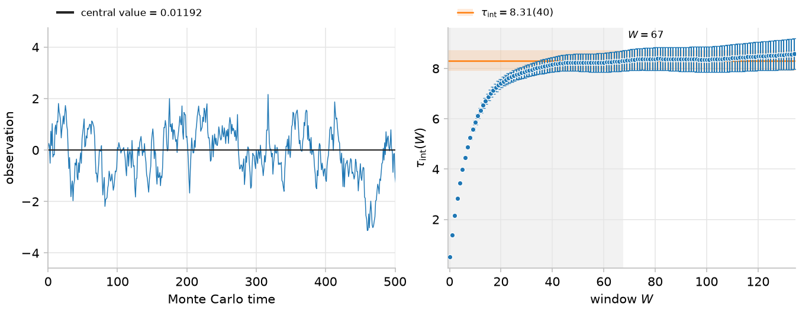
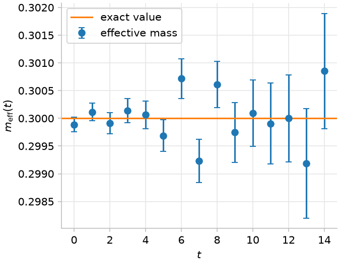

# statpy

[](https://github.com/spieseba/statpy/actions/workflows/ci.yml)

statpy is a Python library for statistical analysis, error propagation and autocorrelation estimation of Markov chain Monte Carlo data (e.g. from lattice field theory simulations).

- Error estimation and propagation for autocorrelated data by jackknife and bootstrap with binning, and by the gamma method, which estimates the autocorrelations directly
- Built on [NumPy](https://numpy.org) and [JAX](https://github.com/jax-ml/jax):
  - Data storage and core statistical calculations with NumPy
  - Function transformations with JAX: automatic differentiation (autodiff) for gamma-method error propagation, vectorized evaluation of jackknife and bootstrap replicates (`vmap`), and just-in-time compilation (`jit`)
- Nonlinear least-squares fits with error propagation by all three methods, optionally with numba-compiled models
- Quantities that combine multiple independent ensembles and external inputs: autocorrelations and errors are estimated per ensemble
- Delayed binning (Spiegel, Lehner, [Phys. Rev. D 111](https://doi.org/10.1103/mj3d-yq87)): jackknife errors of derived quantities at any bin size, without repeating the analysis

statpy enables JAX's 64-bit mode on import.

## Installation

Requires Python >= 3.14 and [uv](https://docs.astral.sh/uv/getting-started/). From your project directory:

```bash
uv add /absolute/path/to/statpy             # add --editable for an editable installation of statpy
uv run python -c "import statpy; print(statpy.__file__)"
```

## Examples

### Example 1: a single Markov chain

We generate a chain with known integrated autocorrelation time and compare the error estimates of its mean from gamma method, jackknife, and bootstrap.

```python
import numpy as np
import statpy as sp

# Generate Markov chain with num_configs samples with integrated autocorrelation time tau via AR(1):
num_configs = 100_000
tau = 8.0
rng = np.random.default_rng(1337)
chain = sp.simulation.ar1.generate_chains(tau=tau, num_configurations=num_configs, rng=rng)
x = sp.Variable.from_data(
    observations=chain,
    layout=sp.Layout("Ensemble-E", monte_carlo_times=np.arange(num_configs)),
    bootstrap_indices=sp.statistics.bootstrap.generate_bootstrap_indices(500, num_configs, rng)
)

x.summarize()
```

```text
Ensemble-E: N = 100000, shape (), S = 1.5
value      gamma_error  jackknife_error  bootstrap_error  tau_int   W
0.012(13)  0.013        0.0032           0.0034           8.31(40)  67
```

The AR(1) chain has unit variance, so the exact error of its mean is `sqrt(2 tau / num_configs)` = 0.0126. The gamma method estimates it correctly (within margin of errors), and also estimates `tau_int` close to the exact value of 8. Jackknife and bootstrap ignore autocorrelations, so their errors are too small by roughly a factor of four.

The left plot shows the first 500 samples of the Monte Carlo history. The right plot shows the integrated autocorrelation time against the summation window `W`:

```python
import matplotlib.pyplot as plt

fig, (ax0, ax1) = plt.subplots(1, 2, figsize=(9, 3.5), layout="constrained")
x.plot_observations(ax0).set_xlim(0, 500)
x.gamma_method().plot_integrated_autocorrelation_time(ax1)
fig.savefig("markov_chain.png", dpi=150)
```



Binning removes the autocorrelations in the chain, so jackknife and bootstrap can estimate the error if the bin size is chosen appropriately (bin size >> `tau`). The bootstrap indices have to be adapted accordingly:

```python
for bin_size in (4, 16, 64, 128):
    bootstrap_indices = sp.statistics.bootstrap.generate_bootstrap_indices(500, num_configs // bin_size, rng)
    binned = x.bin(bin_size, bootstrap_indices=bootstrap_indices)
    print(f"bin size {bin_size}:")
    binned.summarize()
```

```text
bin size 4:
Ensemble-E: N = 25000, shape (), S = 1.5
value      gamma_error  jackknife_error  bootstrap_error  tau_int   W
0.012(13)  0.013        0.0059           0.006            2.44(13)  19
bin size 16:
Ensemble-E: N = 6250, shape (), S = 1.5
value      gamma_error  jackknife_error  bootstrap_error  tau_int    W
0.012(13)  0.013        0.0096           0.0094           0.927(60)  7
bin size 64:
Ensemble-E: N = 1562, shape (), S = 1.5
value      gamma_error  jackknife_error  bootstrap_error  tau_int    W
0.012(14)  0.014        0.012            0.012            0.680(67)  4
bin size 128:
Ensemble-E: N = 781, shape (), S = 1.5
value      gamma_error  jackknife_error  bootstrap_error  tau_int    W
0.012(14)  0.014        0.012            0.012            0.641(89)  4
```

Jackknife and bootstrap errors grow with the bin size and approach the exact 0.0126 at bin sizes well above `tau`. The gamma-method error stays about the same. `tau_int` is then understood in units of bins and approaches 1/2 because the bins become independent.

### Example 2: a lattice QCD correlator

We simulate a correlator `2 exp(-0.3 t)` with true mass 0.3 and extract that mass. All time slices share a large AR(1) chain, which makes them strongly correlated, and each has a small chain of its own. As in real correlators, the relative noise grows with `t`.

```python
import numpy as np
import statpy as sp

# Simulate 6400 measurements of 16 time slices
num_configs = 6400
t = np.arange(16)
rng = np.random.default_rng(0)
shared_chain = sp.simulation.ar1.generate_chains(tau=2.0, num_configurations=num_configs, rng=rng)
separate_chains = sp.simulation.ar1.generate_chains(tau=np.full(16, 4.0), num_configurations=num_configs, rng=rng)
relative_noise = 0.02 * np.exp(0.15 * t)
observations = 2 * np.exp(-0.3 * t) * (1 + relative_noise * (shared_chain[:, None] + 0.1 * separate_chains))

correlator = sp.Variable.from_data(
    observations=observations,
    layout=sp.Layout("Ensemble-E", monte_carlo_times=np.arange(num_configs)),
    bootstrap_indices=sp.statistics.bootstrap.generate_bootstrap_indices(500, num_configs, rng)
)
```

The effective mass `log(C(t) / C(t+1))` is a nonlinear function of correlator time slices. `Variable.derive` propagates its errors through this function. For automatic gamma-method error propagation, write the function using `jax.numpy` (`jnp`) so JAX can compute its derivatives. The input data remain NumPy arrays.

Functions that JAX cannot differentiate can still be used for jackknife and bootstrap propagation; gamma-method propagation requires supplying their Jacobians explicitly.

```python
import jax.numpy as jnp
import matplotlib.pyplot as plt

effective_mass = sp.Variable.derive(lambda c: jnp.log(c[:-1] / c[1:]), correlator)

fig, ax = plt.subplots(figsize=(6, 3.5), layout="constrained")
ax.errorbar(t[:-1], effective_mass.central_value, effective_mass.gamma_method().error, fmt="o", capsize=3, label="effective mass")
ax.axhline(0.3, color="C1", label="exact value")
ax.set(xlabel="$t$", ylabel=r"$m_\mathrm{eff}(t)$")
ax.legend()
sp.plot.style_axes(ax)
fig.savefig("effective_mass.png", dpi=150)
```



We perform an uncorrelated fit of the correlator to `A exp(-m t)` with time slices 2 to 15 using the `least_squares_fit` method. The derivatives are computed automatically via autodiff:

```python
fit = correlator.least_squares_fit(
    model=sp.qcd.correlator.models.exp(),
    fit_range=np.arange(2, 16),
    initial_parameters=np.array([2.0, 0.3])
)
fit.summarize(components={"A": 0, "m": 1}) 
```

```text
fit range 2..15 (14 points), chi2/dof = 1.08/12 = 0.0902, p-value = 1.00
Ensemble-E: N = 6400, shape (2,), S = 1.5
component  value        gamma_error  jackknife_error  bootstrap_error  tau_int   W
A          1.99988(28)  0.00028      0.00011          0.00011          2.99(31)  20
m          0.30001(22)  0.00022      0.00011          0.0001           2.04(18)  14
```

The mass agrees with the true value 0.3 within its error. `chi2/dof` is well below 1 and the p-value close to 1, as usual for an uncorrelated fit to strongly correlated time slices.

As in Example 1, binning brings the jackknife error of `m` close to the gamma-method error. Delayed binning allows us to do this without repeating the fit:

```python
for bin_size in (1, 8, 16, 32, 64):
    print(bin_size, f"{fit.parameters.jackknife_variance(bin_size)[1]**.5:.1e}")
```

```text
1 1.1e-04
8 1.9e-04
16 2.1e-04
32 2.3e-04
64 2.5e-04
```

### Example 3: combining ensembles

Variables from independent ensembles are combined with `derive`. With the gamma method and jackknife, the error is computed for each ensemble on its own and the variances are added; `summarize` shows the contribution of each ensemble. We form the ratio of the means of two chains with means 1 and 2, standard deviation 0.1, and different lengths and autocorrelation times.

```python
import numpy as np
import statpy as sp

rng = np.random.default_rng(0)
chain_a = 1 + 0.1 * sp.simulation.ar1.generate_chains(tau=2.0, num_configurations=4000, rng=rng)
chain_b = 2 + 0.1 * sp.simulation.ar1.generate_chains(tau=8.0, num_configurations=2000, rng=rng)
a = sp.Variable.from_data(observations=chain_a, layout=sp.Layout("Ensemble-A", monte_carlo_times=np.arange(4000)))
b = sp.Variable.from_data(observations=chain_b, layout=sp.Layout("Ensemble-B", monte_carlo_times=np.arange(2000)))

ratio = sp.Variable.derive(lambda a, b: a / b, a, b)
ratio.summarize()
```

```text
Ensemble-A: N = 4000; Ensemble-B: N = 2000, shape (), S = 1.5
ensemble    value       gamma_error (variance share)  jackknife_error (variance share)  tau_int   W
total       0.4960(29)  0.0029 (100.0%)               0.00095 (100.0%)
Ensemble-A              0.0016 (29.7%)                0.00078 (67.6%)                   1.96(21)  13
Ensemble-B              0.0024 (70.3%)                0.00054 (32.4%)                   9.7(24)   43
```

The exact errors are 0.0016 from ensemble A and 0.0022 from ensemble B, 0.0027 in total. The jackknife errors are shown without binning and are too small, as in Example 1.

### Example 4: real lattice data

A more involved example can be found in [caa-control-variates](https://github.com/spieseba/caa-control-variates), which applies covariant approximation averaging, a control-variates technique, to real lattice QCD correlator data and reduces the statistical error by up to an order of magnitude.

## Roadmap

- Error budget with the contributions of each ensemble and external input
- Gamma-method covariance, with bias correction of its inverse for correlated fits
- Expected chi-squared for uncorrelated fits (Bruno, Sommer, [arXiv:2209.14188](https://arxiv.org/abs/2209.14188))
- Exponential tail correction (Schaefer, Sommer, Virotta, [arXiv:1009.5228](https://arxiv.org/abs/1009.5228))
